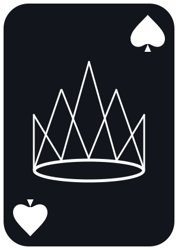

# Rounders



Nymbl Design Engineer Challenge: Harbor & Pine staffing flow.

Surface B: pick an open role, see who could fill it, compare options, assign someone, and see the impact on their load and everyone else's before committing.

The brief never names the tool itself, "Harbor & Pine" is the fictional client firm the sample data describes, not a product name (see [staffing-challenge-data/README.md](staffing-challenge-data/README.md)). I named it **Rounders**: the poker movie about reading people and making calculated bets under incomplete information, which is close to what the tool actually asks a Resource Manager to do, judge a Tentative assignment on a 60%-win-probability project, or a candidate whose logged hours disagree with the plan.

## Run it

```
npm install
npm run dev
```

No backend. Reads [`staffing-challenge-data/staffing_data.json`](staffing-challenge-data/staffing_data.json) directly (mirrored into `src/data/` for the build; see the AI log for why).

## Required deliverables

- **Design concept** [docs/design-concept.md](docs/design-concept.md): information structure, key states, the path from spotting a problem to acting on it, keyboard operability.
- **Coded prototype**: this app. Core logic in [src/lib/capacity.ts](src/lib/capacity.ts) and [src/lib/matching.ts](src/lib/matching.ts), flow assembled in [src/App.tsx](src/App.tsx).
- **AI process log** [docs/ai-process-log.md](docs/ai-process-log.md).
- **Problem statement** [docs/problem-statement.md](docs/problem-statement.md).

The sample data's own ground rules ask for one more thing: "If you do [add fields, derive values or restructure the data], note it in your decision log." That log is [docs/decision-log.md](docs/decision-log.md), every added field, every derived value, and the three real anomalies in the data and how each was handled instead of silently fixed.

## Beyond the required four

- **Competitive analysis** [docs/competitive-analysis.md](docs/competitive-analysis.md): Float, Runn, Resource Guru, Forecast, Kantata, and Productive.io, checked against Harbor & Pine's scale before assuming anything here needed inventing from scratch.
- **Six wireframes** [docs/wireframes/](docs/wireframes/): the three Surface B states plus three flows the coded prototype doesn't cover (the Monday view, a Delivery Manager's request flow, and resolving a Proposed project's win/loss outcome).
- **The same core screens in Figma**, built from real Material 3 Design Kit components, not flat shapes: [figma.com/design/6DSWdNL44aREEIR4J9JV0s](https://www.figma.com/design/6DSWdNL44aREEIR4J9JV0s/dwest?node-id=47-563).
- **An accessibility pass** against the live app: measured contrast ratios, not eyeballed, logged in [docs/ai-process-log.md](docs/ai-process-log.md) and tracked in Linear.
- **A walkthrough deck** [figma.com/slides/5lbawUAgE5OUBQ6APvf1nF](https://www.figma.com/slides/5lbawUAgE5OUBQ6APvf1nF): the problem, the market check, real screenshots of the flow working, and the three decisions worth defending. Speaker notes with the engineering nitty-gritty in [docs/speaker-notes.md](docs/speaker-notes.md).
- **Light and dark mode**, the toggle in the header, or it follows your system by default. The severity ladder (what makes a load bar or a badge read as urgent) inverts direction between the two rather than just inverting colors: contrast against the page is what signals urgency in both.

## Tracking

Full breakdown lives in the [Nymbl Design Engineer Challenge](https://linear.app/timewarptrivia/project/nymbl-design-engineer-challenge-cd1872118e5a) Linear project, 15 issues, all done. Nothing's currently open.

## Notable judgment calls

Documented inline where they live in the code (search for comments: they explain *why*, not *what*), and summarized in the design concept doc. The short version: three separate visible facts drive candidate ranking instead of one blended score, Tentative assignments on Proposed projects are tracked but never merged into Confirmed totals, and logged-hours-vs-plan divergence is surfaced inline rather than trusted silently either way.
